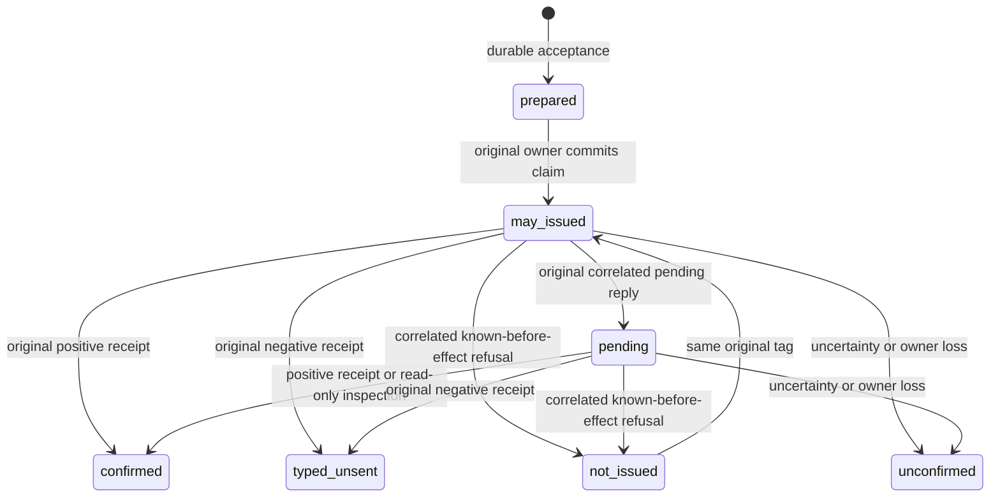

# Browser input custody

`browser-input-journal.js` owns IndexedDB records and exclusive Web Locks.
`input-delivery.js` connects those records to the authenticated input and receipt
APIs. Editable controls acknowledge storage acceptance, not provider delivery.
Neither module creates an account, permission, native worker grant or recovery
authority.

The browser must support strict IndexedDB durability and report a strict
transaction. Unsupported or ignored strict options pause sending before any
transport effect. A persistent error makes owned terminals read-only, retains
the first unqueued event for copying, and leaves editable drafts intact. It does
not clear the hold or retry input automatically.

Every page creates a fresh cryptographic issuer. The device/SSE identity is
separate. A record fixes its issuer, session, sequence, exact text, dispatch choice
and SHA-256 fingerprint. Counter allocation and insertion of an entire split
paste commit in one transaction. Another page cannot overwrite that record or
allocate new input under its issuer.

The record states are:

A private claim can invoke its initial transport effect once, after the
`may-issued` transaction completes. Serializing or copying a claim does not copy
that capability. Pending records use only `GET input-receipt` afterward. Missing,
evicted, mismatched and restarted receipt evidence never means “not issued.”
Unknown input is retained with a durable session hold; it is not removed or
retagged. A correlated capacity/unavailable refusal is the bounded exception:
it proves no effect was dispatched and allows the same original tag to retry.

Only the original page uses its new issuer over WebSocket. Prepared records
adopted from a closed page keep their original tags and use HTTP, so a bare
WebSocket sequence acknowledgment cannot settle an adopted record. An actual
exclusive issuer lock and exact owner-token/revision checks are required for
adoption. May-issued, pending and uncertain records are held on reload. Anonymous
access deliberately never adopts another page's prepared input.

The principal partition comes only from `GET /api/input-identity`. Authenticated
scope or epoch changes pause sending. Genuine anonymous mode remains supported
without inventing an account. A different sign-in cannot inherit another
partition's pending input. Authentication and session access are still checked
by the server for every request.

Legacy localStorage snapshots are copied without changing their bytes or deleting
the shared key. Their pending text is quarantined without guessed ownership.
There is no automatic migration replay. Reads and retention have explicit bounds:
4,096 records/issuer entries per partition, four million pending UTF-16 code units,
and 64 retained legacy snapshot variants of at most eight MiB each. Reaching a
bound refuses new acceptance; it does not evict uncertain records.

Input handlers keep editable drafts and one-shot modifiers until storage
acceptance. Draft revisions distinguish erase/retype from unchanged text. Failed
acceptance retains a visible copy only for orphan raw terminal events. Editable
controls keep their own draft rather than appending another copy on every failed
Send. Each raw buffer fixes its original session; switching tabs never retags its
bytes. Clear first accepts the original buffered text, then queues its control;
new typing makes an older Clear stale. Raw pauses do not clear on a tab switch
or terminal recreation. A separate existing physical `/send-key` action remains outside the
journal effect contract. It waits for actual confirmation of earlier overlay
input and rechecks the original selected session; pending or negative outcomes
require an explicit later attempt. Its native key implementation is unchanged.

The browser protocol marker fences stale browser transports before server input
admission. It is compatibility metadata, not authentication. Old scripts can
still write their legacy localStorage key; new clients never overwrite or trust
that key as current custody. This does not provide cross-process backend effect
idempotency, native process identity, durable receipt reconciliation, or a command
that clears an uncertain hold. Those remain separate release requirements.

## Editable draft ownership

Local terminal editors reserve original character identities at each action. Storage acceptance consumes only those characters; appended text and equal-byte delete/retype edits remain separate intents. Consecutive Enter gestures cannot claim the same characters twice. Failed earlier actions prevent dependent actions from forwarding only a later tail. The editor receipt is separate from the backend delivery receipt.

Flushed-character deletion uses the same editor ownership boundary. A later draft or replacement marker cannot be cleared by an earlier completion. Composer transfer consumes a local draft only when its original editor remains current. If a later edit or editor replacement cancels a transfer after the original flushed prefix was erased, a read-only copy retains the complete original transfer, including that erased prefix, with its original session label. Such copies are local memory only, never sent or merged automatically, and do not grant or pause input authority. Copy them before reloading and check the terminal before using them; an earlier action may already have queued a control character.
